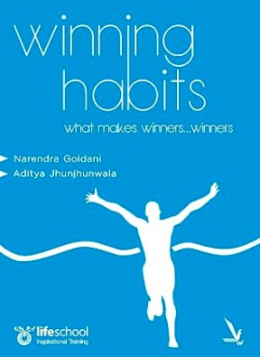

# Books

## Restless to Remarkable
### A companion for parents and teenagers

For the young person who knows they are capable of more, but hasn't found the door yet. And for the parent trying to help without getting in the way.

This book is about building yourself through real work, not credentials. It is for young people navigating the gap between what they were told success looks like and what they actually want to build, and for the parents who love them.

[Buy on Amazon India](https://www.amazon.in/Restless-Remarkable-companion-parents-teenagers/dp/B0GN3F53Q9/) or at leading bookstores.

---

## Winning Habits
### Co-author, Narendra Goidani with Aditya Jhunjhunwala

A practical guide to the habits that build lasting success. Co-authored with Narendra Goidani.

[Buy on Amazon India](https://www.amazon.in/Winning-Habits-Narendra-Goidani-ebook/dp/B086QLYJPK/)

